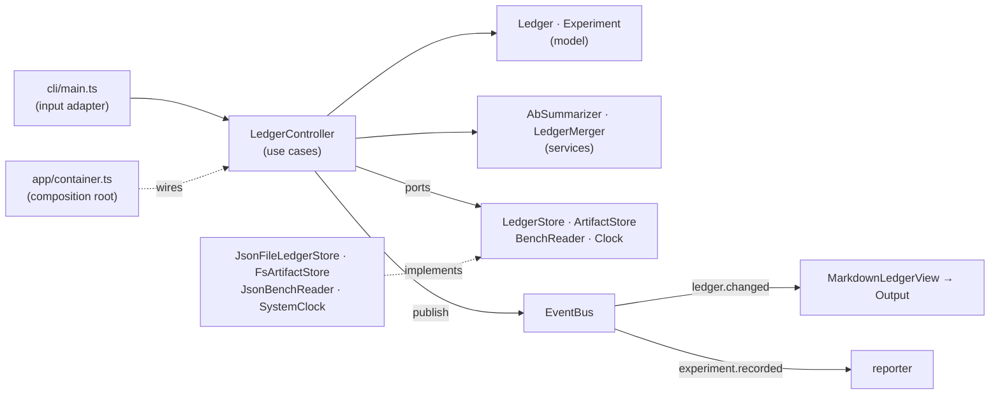

# Architecture

perf-ledger is small, but it is structured so each part has one reason to change and every
dependency points inwards, towards the model.

## The principles, where they live

| principle | where | what it buys |
|---|---|---|
| **Single responsibility** | `Ledger` owns ordering and id uniqueness only; `AbSummarizer` only compares two runs; `MarkdownLedgerView` only renders; `JsonFileLedgerStore` only reads and writes the file. | A change to the Markdown layout touches one class; a new storage touches one adapter. |
| **Model-view-controller** | Model: `src/domain`. View: `src/views` (pure `render(ledger): string`). Controller: `src/controller` (use cases). The CLI is an input adapter in front of the controller. | Views are testable without I/O; a second view (HTML, a dashboard) needs no controller change. |
| **Dependency injection / inversion of control** | The controller receives `ControllerDeps`; only `app/container.ts` calls `new` on adapters. | Tests run every use case against in-memory fakes (`test/fakes.ts`); users swap storage or bench formats by building their own container. |
| **Ports and adapters** | `src/ports.ts` holds the interfaces; `src/adapters` the file-system implementations. | The core never imports `node:fs`. |
| **Publish / subscribe** | The controller publishes `experiment.recorded`, `experiment.renumbered`, `ledger.changed`; the composition root subscribes the Markdown view and the reporter. | Recording does not know that a file is re-rendered or a line printed; adding a Slack notifier is one `events.on`. |
| **Open / closed** | A new benchmark format is a config entry (`JsonBenchReader`); a new id scheme is an `IdStrategy`; a new output is a `LedgerView` + `Output`. | Extension without editing the core. |
| **Don't repeat yourself** | One place formats a metric (`AbSummarizer.phrase`), one place escapes a table cell, one place resolves paths (`loadConfig`). | Formats cannot drift between commands. |
| **Objects own their invariants** | `createExperiment` validates and freezes; `Ledger.add` refuses a duplicate id; `renumber` moves an experiment's result paths with its id. | An invalid or ambiguous ledger cannot be built through the API. |

## Why merge is a use case

The bug it fixes happened while building the example: two sessions working on two branches each
recorded "the next" experiment, both as `EXP-034`, and both copied their raw files into
`results/EXP-034/`. A text merge of `ledger.json` conflicts at best; at worst it keeps two
experiments under one id. `LedgerMerger` treats the integration branch as the base (its ids are
already referenced from pull requests and commits), appends incoming experiments, renumbers
collisions, and reports exactly which files to move, so the base's files in a shared directory
stay where they are.
